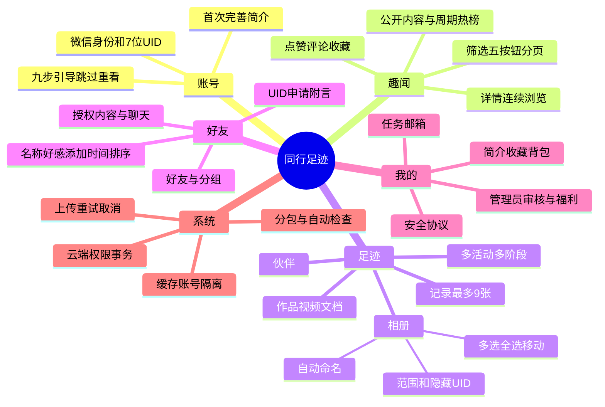
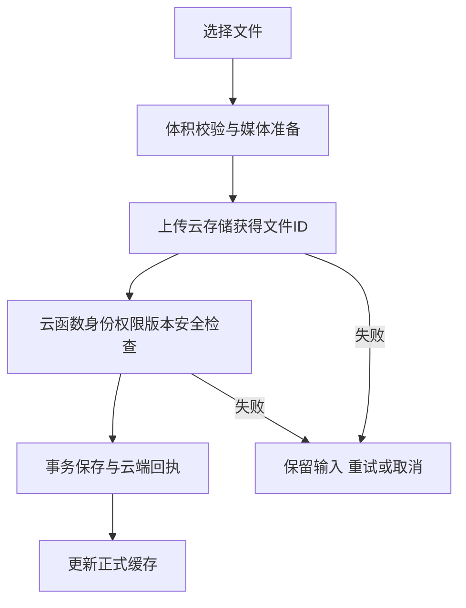
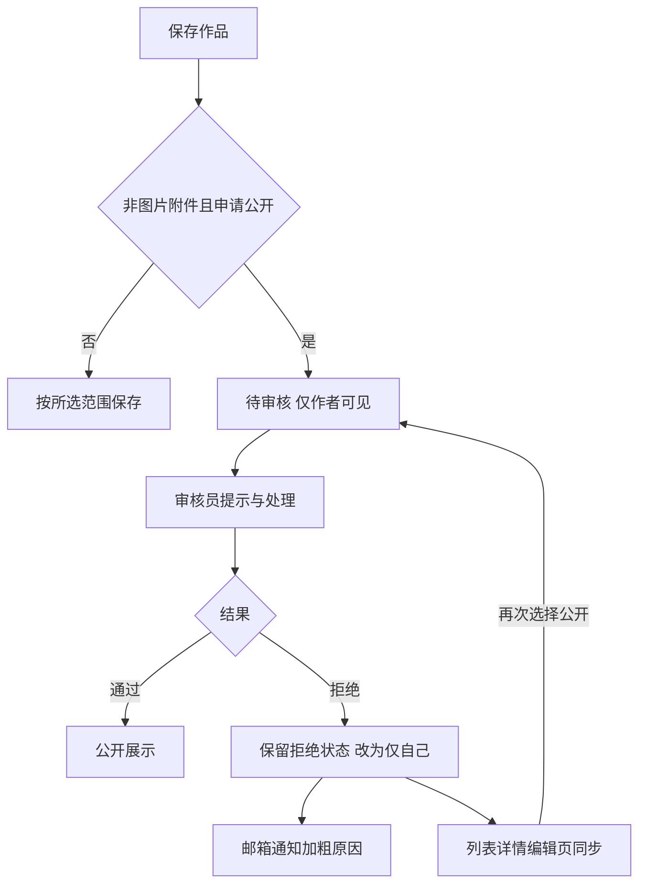
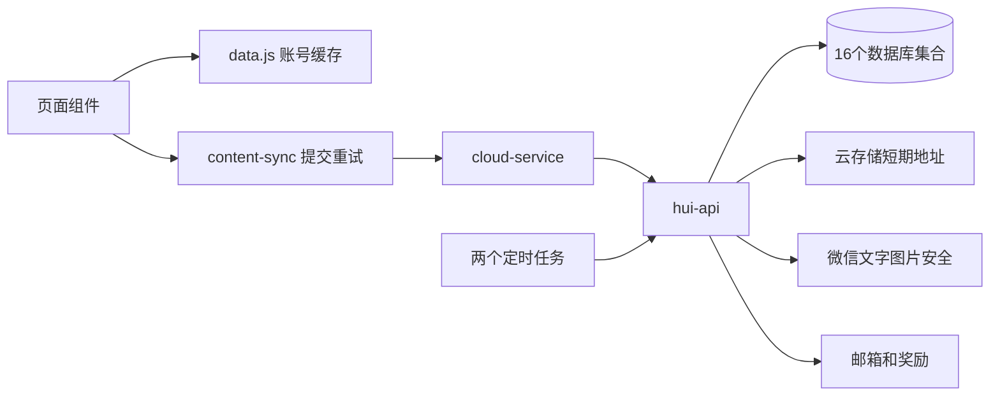

# 功能、逻辑与系统总览

## 功能思维导图

## 主栏目

趣闻展示允许公开的已发布内容，支持最新、本周、月份和年份榜，按活动、类型和关键词筛选。列表和详情分别以页、条跳转。作者 UID 尊重隐藏设置，不把用户名作为公开作品详情的作者信息。

足迹按活动和阶段保存伙伴、相册、记录、作品。自定义活动具有独立归属，删除和改名通过云端原子操作同步关联数据。伙伴只提供自己和好友范围，其他发布内容按功能提供自己、好友、公开范围。

好友包含申请、双向关系、好友与分组视图、备注、聊天、赠礼与好感。默认组可重命名不可删除，新增好友默认归入该组。服务端每次检查访问关系，曾缓存过资料不代表永久授权。

我的包含简介、收藏、背包、任务、邮箱、功能引导、安全与协议、关于模板。管理员额外看到开发者福利和独立作品审核入口，入口与底部标签显示待审核数量。

## 上传与同步

正式内容以云端回执为准，本机缓存加快显示，提交队列与正式列表分开。账号切换隔离缓存，页面先显示后校验，表单编辑时不自动覆盖输入。已同步内容可换设备恢复，未提交草稿不能保证跨设备恢复。

图片单张20MiB、视频压缩后500MiB、其他作品1000MiB。相册可持续追加，选择器单次数量受微信能力限制，记录总数仍为9。安全检查副本与正式图片分开处理。

## 审核流程

文字和图片执行微信安全检查。人工公开审核适用于视频、文档等非图片附件，自己或好友范围不进入该队列。处理时检查当前状态和版本，避免审核已撤回或修改的附件。

原因选填最多200字，未填使用默认规范文案，邮箱单独加粗原因。审核状态、私密范围和拒绝邮件同一事务提交，失败回滚。旧拒绝记录兼容显示私密，再公开必须重新审核。

## 系统结构

数据库客户端权限关闭，云函数按微信 OPENID 校验。UID只是公开查找编号，管理员身份取自服务端资料或环境变量。`content-manager.js` 负责内容事务，`friend-management.js` 负责分组，`photo-names.js` 负责命名，`media-files.js` 校验媒体。

主包和五个普通分包共同承载页面，保留旧 URL 跳转兼容。代码测试使用内存与模拟接口，不连接生产环境。

## 奖励

| 周期 | 排名 | 奖励 |
| --- | --- | --- |
| 每日 | 1–3 / 4–6 / 7–10 | 3 / 2 / 1 星星 |
| 每周 | 1–5 / 6–10 / 11–20 | 3 / 2 / 1 信封 |
| 每月 | 1–5 / 6–10 / 11–20 | 6 / 4 / 2 礼盒 |
| 每年 | 1 / 2 / 3 | 3 / 2 / 1 纪念册 |

同一作者每周期只按最高名次获得一份。任务、榜单和福利通过云端记账与邮箱领取，赠礼更新好感。当前无付费商店或支付订单。

## 部署边界

使用者需配置自己的 AppID、环境、集合权限与索引、管理员、触发器、存储、下载域名和微信平台声明。实际账号授权、手机文件处理、手势、大文件速度和云环境配额仍需真机验收。
