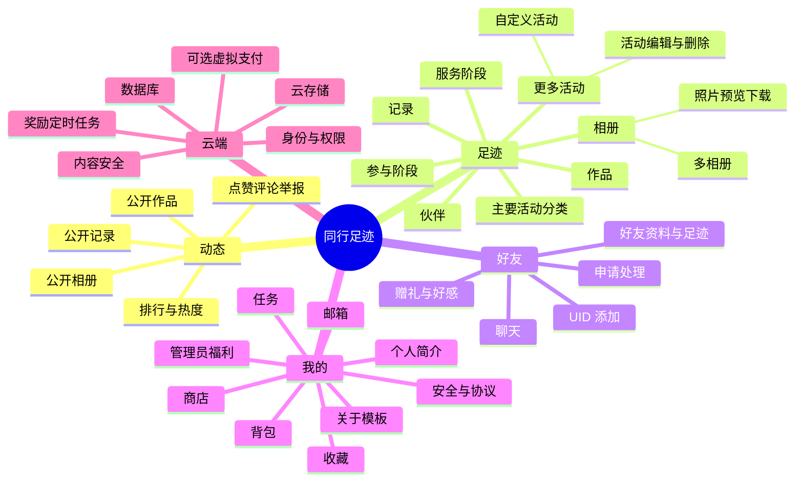

# 同行足迹模板：功能总览与思维导图

“同行足迹”是一套社群成长记录与互动小程序模板。部署者可以替换品牌、活动分类、图片素材与业务规则，用于学校、社团、公益组织、兴趣小组或其他活动社区。

## 主要能力

### 动态

- 汇总用户明确公开的相册、记录和作品。
- 支持最新、本周、月度和年度查看方式。
- 支持浏览、点赞、评论、回复、收藏与举报。

### 足迹

- 首页展示四个主要活动分类，更多活动页展示预置分类和自定义活动。
- 每类活动可分为参与阶段与服务阶段。
- 每个阶段包含伙伴、相册、记录和作品。
- 可创建多个活动和多个相册，并分别设置名称与封面。

### 好友

- 通过 7 位 UID 申请添加好友，支持同意、拒绝、备注与删除。
- 好友可查看对方授权开放的足迹和简介。
- 支持一对一聊天、历史赠礼补算和好感等级。

### 我的

- 编辑头像、昵称、简介、标签、成长年限和活动经历。
- 查看收到的礼物、收藏、背包、任务、商店和邮箱。
- 管理员可向全部用户或指定 UID 发放有期限的奖励邮件。
- 安全与协议页包含隐私、社区规范、反馈和账号删除申请。

### 云端与治理

- OPENID 作为身份主键，7 位 UID 只用于公开查找。
- 云函数统一校验跨用户权限、库存、奖励和支付状态。
- 用户文本与图片写入前调用微信内容安全接口。
- 云存储文件使用 `cloud://` ID 保存并按需换取临时访问地址。
- 虚拟支付模块可选，支持下单、回调、查单、幂等发货和退款审计。

## 思维导图

## 模板化建议

1. 先修改 `config/app-config.js` 与 `data/mock-data.js`。
2. 替换 `assets/images/` 中的品牌图片，并确认素材授权。
3. 根据实际功能删减支付、聊天、评论或礼物模块。
4. 同步修改公众平台的服务类目、隐私保护指引与 UGC 声明。
5. 在独立测试云环境完成双账号验收后再迁移或发布正式环境。
